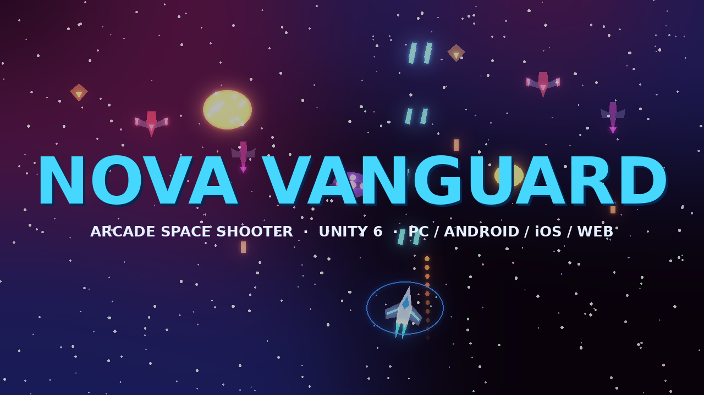
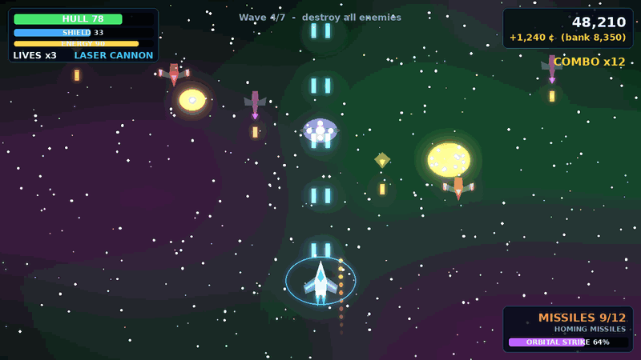
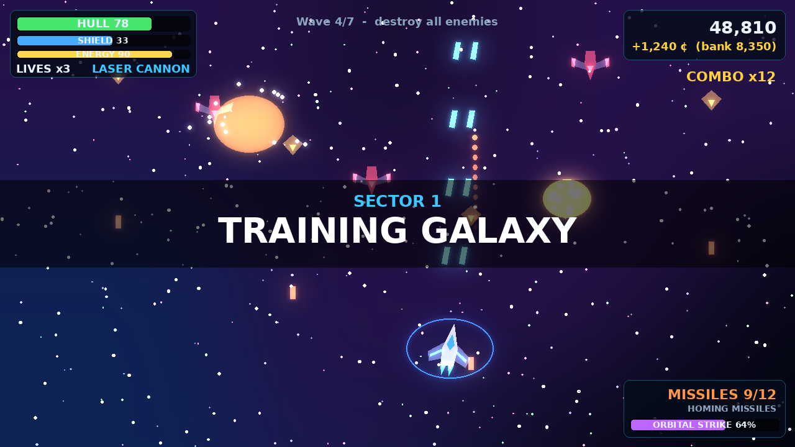
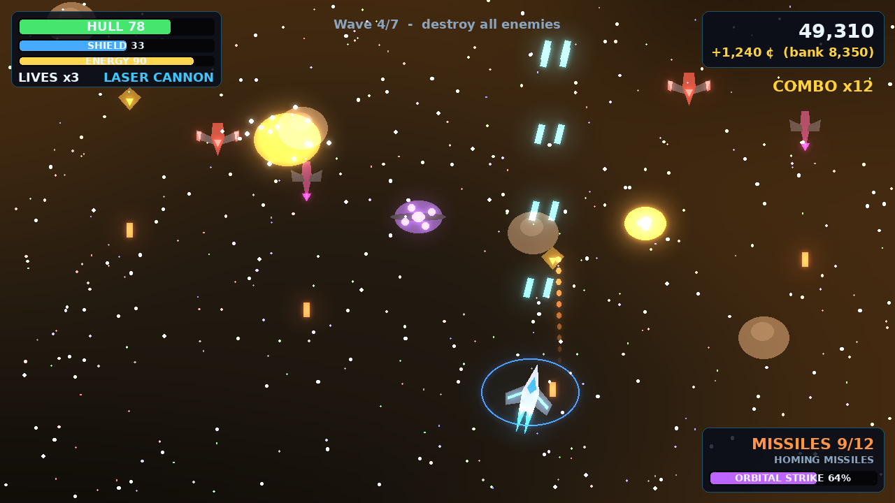
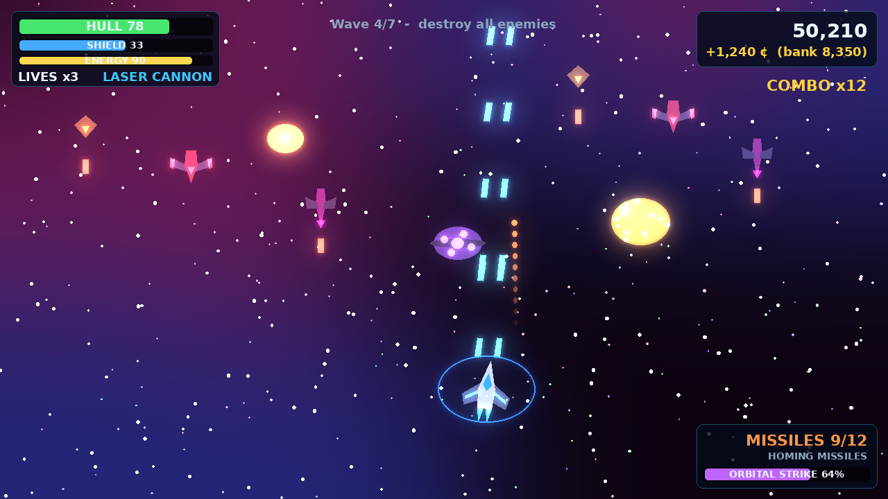
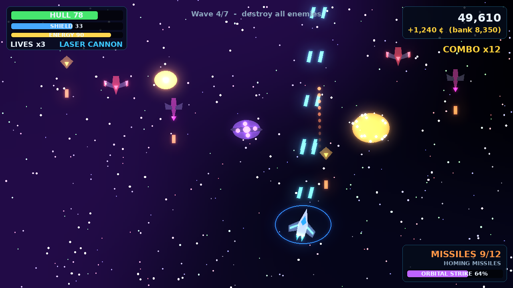
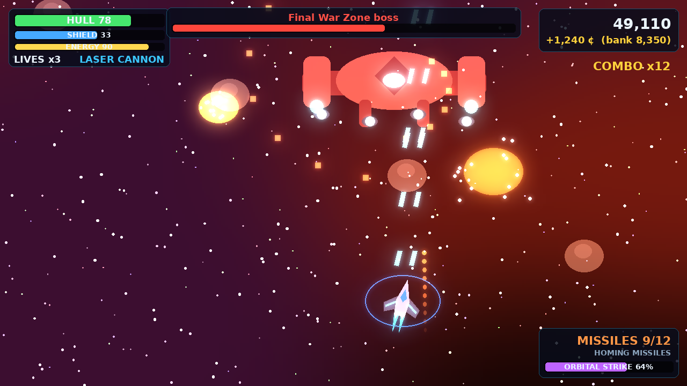
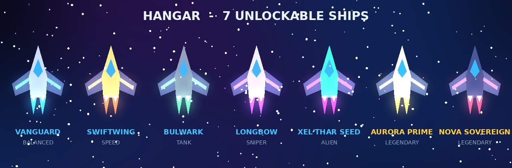

# Nova Vanguard



**A polished arcade 3D space shooter built in Unity 6 for PC, Android, iOS and WebGL.**

<p align="center"><a href="https://play.unity.com/en/games/fd321b04-e852-4489-9777-7d402ad22f20/nova-vanguard"></a> <a href="https://jaigod.github.io/nova-vanguard/"></a></p>

<p align="center">
  
</p>

<p align="center"><b>▶ <a href="docs/media/gameplay.mp4">Watch the gameplay video (MP4)</a></b> &nbsp;·&nbsp; <a href="https://github.com/JaiGod/nova-vanguard/raw/main/docs/media/gameplay.mp4">direct download</a></p>

Fly through seven sectors of escalating chaos: asteroid belts, alien territory, blinding nebulae, ancient machine worlds and a dark-matter sector where gravity itself is the enemy. Four primary weapons, four secondaries, four ultimates, seven unlockable ships, a persistent upgrade tree and seven multi-phase bosses with shield generators and weak points.

> Everything in the game, every ship model, particle effect, sound and music track, is generated procedurally at runtime from C#. The repo contains **zero binary art assets**, so it clones in seconds and is 100% readable. Drop real models/audio in later and the architecture is ready for them.

| | |
|---|---|
| Engine | Unity 6 (6000.0 LTS or newer) |
| Rendering | Universal Render Pipeline 17 (bloom, ACES tonemapping, vignette, FXAA) |
| Input | New Input System + legacy fallback, touch, gamepad |
| Platforms | Windows, macOS, Linux, Android (APK/AAB), iOS, WebGL |
| License | MIT |

---

## Quick start

1. Install **Unity 6** (6000.0.x or newer) through Unity Hub with the modules you want to build for (Android Build Support, iOS Build Support, WebGL Build Support).
2. Clone this repository:
   ```bash
   git clone https://github.com/JaiGod/nova-vanguard.git
   ```
3. In Unity Hub choose **Add → Add project from disk** and pick the `nova-vanguard` folder. Open it.
4. First open takes a minute while packages import. The editor script `NovaProjectSetup` then runs automatically and:
   - creates the URP pipeline + renderer assets and assigns them,
   - creates the base materials in `Resources/NovaMaterials`,
   - sets player settings (company, bundle IDs, orientation, IL2CPP, Vulkan/GLES3),
   - switches *Active Input Handling* to **Both** (Unity may ask you to restart; say yes),
   - adds `Main.unity` to Build Settings.
5. Open `Assets/NovaVanguard/Scenes/Main.unity` and press **Play**.

If anything looks off, run **Nova Vanguard → Run Project Setup** from the menu bar.

Full guides: [Installation](docs/INSTALLATION.md) · [Controls](docs/CONTROLS.md) · [Building](docs/BUILD.md) · [Architecture](docs/ARCHITECTURE.md) · [API](docs/API.md) · [Release notes](docs/RELEASE_NOTES.md)

---

## Screenshots

| Sector 1 – Training Galaxy | Sector 2 – Asteroid Belt |
|---|---|
|  |  |
| **Sector 4 – Nebula Zone** | **Sector 6 – Dark Matter Sector** |
|  |  |





> The images and video in `docs/media` are rendered from the game's own colour palettes, ship silhouettes and HUD layout to preview the look and feel. Replace them with in-engine captures (Window → General → Recorder, or your platform's screen capture) once you have built the project locally.

---

## Controls

| Action | PC | Gamepad | Mobile |
|---|---|---|---|
| Move | **WASD** / arrows | Left stick | Virtual joystick (or drag-to-move) |
| Aim | **Mouse** | Right stick | Auto-aim |
| Fire primary | **Left click** / J | RT | FIRE button (or Auto-fire) |
| Secondary weapon | **Right click** / F | RB | MSL button |
| Boost | **Shift** | LT | BOOST button |
| Ultimate | **Space** | Y | ULT button |
| Switch primary | 1-4 / E / scroll up | X | WPN button |
| Switch secondary | Q / scroll down | LB | SEC button |
| Pause | Esc / P | Start | ⏸ |

---

## Features

**Player ship** – acceleration/deceleration, banking, procedural thruster particles, boost (energy-draining), hull + regenerating shield + energy, invulnerability frames, three lives per sector.

**Weapons**
- Primary: Laser Cannon, Plasma Gun (splash), Machine Gun, Pulse Cannon (5-way)
- Secondary: Missiles, Homing Missiles, EMP Bomb (stun + bullet clear), Cluster Rockets
- Ultimate: Orbital Strike, Energy Wave, Black Hole Generator, Drone Swarm

**Enemies** – Scout (fast zig-zag), Fighter (strafing line), Interceptor (aggressive charge & loop), Bomber (slow, radial fire, explodes on death), Elite (aimed burst fire, heavy). Difficulty scales per sector and wave.

**Bosses** – seven bosses, each with three health phases, a shield that only drops when its generators are destroyed, a glowing core weak point (2× damage), cinematic entrance, and pattern sets drawn from: radial burst, spiral, aimed volley, shotgun, ring wall (find the gap), homing missile barrage, minion summons and a telegraphed laser sweep.

**Galaxy** – 7 sectors: Training Galaxy → Asteroid Belt → Alien Territory → Nebula Zone → Ancient Machine World → Dark Matter Sector → Final War Zone. Each introduces enemies, hazards (asteroids that split, debris, comets, pulsing laser gates, wormholes, black holes) and a tougher boss.

**Progression** – credits from kills, pickups and sector clears (half kept on death); 7 upgrade stats × 10 levels; 7 ships (Balanced, Speed, Tank, Sniper, Alien, two Legendary); weapon unlocks.

**Presentation** – URP bloom/tonemapping/vignette with hit-reactive chromatic aberration, trauma-based screen shake, parallax starfield, drifting nebulae, a planet and a space station in the background, per-sector lighting themes, hit-stop scale punches, floating score text, combo counter.

**Audio** – synthesized SFX for every weapon/explosion/UI event, four generated music tracks (menu, combat, boss, victory) with crossfading, positional audio, voice alert hook (drop clips in `Resources/Audio/Voice`).

**Save system** – JSON save with atomic writes, `ISaveBackend` abstraction (file / PlayerPrefs for WebGL / cloud-mirror wrapper ready for Unity Cloud Save), statistics tracking, settings.

**Performance** – object pooling for bullets, missiles, enemies, hazards, pickups and VFX; no `Instantiate` during gameplay; no shadows; single draw-call-friendly materials; automatic quality tier on mobile (resolution scaling on low-end devices); 60 FPS mobile / 120 FPS desktop frame-rate targets.

---

## Project layout

```
Assets/NovaVanguard/
  Editor/        NovaProjectSetup (auto setup), NovaBuild (menu + CI build entry points)
  Resources/     NovaMaterials (generated), Audio/{Sfx,Music,Voice} (optional real clips)
  Scenes/        Main.unity – one Bootstrap object; everything else is created in code
  Settings/      URP assets (generated on first open)
  Scripts/
    Audio/       AudioManager, Synth
    Combat/      Unit (health base), Projectile, Missile, GravityWell
    Core/        Bootstrap, GameManager, Pool, MaterialLibrary, ShipFactory, CameraRig, PostFx, GameBounds
    Data/        GameData – every ship, weapon, enemy, sector and boss definition
    Enemies/     Enemy (5 AI types), Boss (+ BossGenerator)
    Input/       InputRouter (keyboard/mouse/gamepad/touch → intents)
    Player/      PlayerShip, PlayerWeapons, UltimateSystem (+ Drone, BlackHoleEffect)
    Save/        SaveSystem, backends
    UI/          UI (builder), HUD, TouchControls, UIManager (all menus)
    VFX/         Vfx (procedural particle systems, shockwaves, thrusters)
    World/       SpaceBackground, Hazards (Asteroid/Debris/Comet/LaserGate/Wormhole/Pickup)
Packages/manifest.json
ProjectSettings/
docs/
```

## Building

Menu: **Nova Vanguard → Build → {Windows, macOS, Linux, Android APK, Android AAB, iOS, WebGL}**. Output lands in `Builds/`.

Headless (CI or terminal):
```bash
Unity -batchmode -quit -projectPath . -executeMethod NovaVanguard.Editor.NovaBuild.Android -logFile build.log
```
See [docs/BUILD.md](docs/BUILD.md) for Android signing, iOS/Xcode and WebGL hosting (GitHub Pages).

## Debug keys (Editor / Development builds)

`F1` god mode · `F2` kill everything on screen · `F3` +5000 credits

## Credits

Design, code, art & audio: **Jaineil Rana (JaKing)**. Built with Unity 6 and URP. MIT licensed, so fork away.
# Nova Vanguard


**A polished arcade 3D space shooter built in Unity 6 for PC, Android, iOS and WebGL.**

<p align="center">
  
</p>

<p align="center"><b>▶ <a href="docs/media/gameplay.mp4">Watch the gameplay video (MP4)</a></b> &nbsp;·&nbsp; <a href="https://github.com/JaiGod/nova-vanguard/raw/main/docs/media/gameplay.mp4">direct download</a></p>

Fly through seven sectors of escalating chaos: asteroid belts, alien territory, blinding nebulae, ancient machine worlds and a dark-matter sector where gravity itself is the enemy. Four primary weapons, four secondaries, four ultimates, seven unlockable ships, a persistent upgrade tree and seven multi-phase bosses with shield generators and weak points.

> Everything in the game, every ship model, particle effect, sound and music track, is generated procedurally at runtime from C#. The repo contains **zero binary art assets**, so it clones in seconds and is 100% readable. Drop real models/audio in later and the architecture is ready for them.

| | |
|---|---|
| Engine | Unity 6 (6000.0 LTS or newer) |
| Rendering | Universal Render Pipeline 17 (bloom, ACES tonemapping, vignette, FXAA) |
| Input | New Input System + legacy fallback, touch, gamepad |
| Platforms | Windows, macOS, Linux, Android (APK/AAB), iOS, WebGL |
| License | MIT |

---

## Quick start

1. Install **Unity 6** (6000.0.x or newer) through Unity Hub with the modules you want to build for (Android Build Support, iOS Build Support, WebGL Build Support).
2. Clone this repository:
   ```bash
   git clone https://github.com/JaiGod/nova-vanguard.git
   ```
3. In Unity Hub choose **Add → Add project from disk** and pick the `nova-vanguard` folder. Open it.
4. First open takes a minute while packages import. The editor script `NovaProjectSetup` then runs automatically and:
   - creates the URP pipeline + renderer assets and assigns them,
   - creates the base materials in `Resources/NovaMaterials`,
   - sets player settings (company, bundle IDs, orientation, IL2CPP, Vulkan/GLES3),
   - switches *Active Input Handling* to **Both** (Unity may ask you to restart; say yes),
   - adds `Main.unity` to Build Settings.
5. Open `Assets/NovaVanguard/Scenes/Main.unity` and press **Play**.

If anything looks off, run **Nova Vanguard → Run Project Setup** from the menu bar.

Full guides: [Installation](docs/INSTALLATION.md) · [Controls](docs/CONTROLS.md) · [Building](docs/BUILD.md) · [Architecture](docs/ARCHITECTURE.md) · [API](docs/API.md) · [Release notes](docs/RELEASE_NOTES.md)

---

## Screenshots

| Sector 1 – Training Galaxy | Sector 2 – Asteroid Belt |
|---|---|
|  |  |
| **Sector 4 – Nebula Zone** | **Sector 6 – Dark Matter Sector** |
|  |  |


> The images and video in `docs/media` are rendered from the game's own colour palettes, ship silhouettes and HUD layout to preview the look and feel. Replace them with in-engine captures (Window → General → Recorder, or your platform's screen capture) once you have built the project locally.

---

## Controls

| Action | PC | Gamepad | Mobile |
|---|---|---|---|
| Move | **WASD** / arrows | Left stick | Virtual joystick (or drag-to-move) |
| Aim | **Mouse** | Right stick | Auto-aim |
| Fire primary | **Left click** / J | RT | FIRE button (or Auto-fire) |
| Secondary weapon | **Right click** / F | RB | MSL button |
| Boost | **Shift** | LT | BOOST button |
| Ultimate | **Space** | Y | ULT button |
| Switch primary | 1-4 / E / scroll up | X | WPN button |
| Switch secondary | Q / scroll down | LB | SEC button |
| Pause | Esc / P | Start | ⏸ |

---

## Features

**Player ship** – acceleration/deceleration, banking, procedural thruster particles, boost (energy-draining), hull + regenerating shield + energy, invulnerability frames, three lives per sector.

**Weapons**
- Primary: Laser Cannon, Plasma Gun (splash), Machine Gun, Pulse Cannon (5-way)
- Secondary: Missiles, Homing Missiles, EMP Bomb (stun + bullet clear), Cluster Rockets
- Ultimate: Orbital Strike, Energy Wave, Black Hole Generator, Drone Swarm

**Enemies** – Scout (fast zig-zag), Fighter (strafing line), Interceptor (aggressive charge & loop), Bomber (slow, radial fire, explodes on death), Elite (aimed burst fire, heavy). Difficulty scales per sector and wave.

**Bosses** – seven bosses, each with three health phases, a shield that only drops when its generators are destroyed, a glowing core weak point (2× damage), cinematic entrance, and pattern sets drawn from: radial burst, spiral, aimed volley, shotgun, ring wall (find the gap), homing missile barrage, minion summons and a telegraphed laser sweep.

**Galaxy** – 7 sectors: Training Galaxy → Asteroid Belt → Alien Territory → Nebula Zone → Ancient Machine World → Dark Matter Sector → Final War Zone. Each introduces enemies, hazards (asteroids that split, debris, comets, pulsing laser gates, wormholes, black holes) and a tougher boss.

**Progression** – credits from kills, pickups and sector clears (half kept on death); 7 upgrade stats × 10 levels; 7 ships (Balanced, Speed, Tank, Sniper, Alien, two Legendary); weapon unlocks.

**Presentation** – URP bloom/tonemapping/vignette with hit-reactive chromatic aberration, trauma-based screen shake, parallax starfield, drifting nebulae, a planet and a space station in the background, per-sector lighting themes, hit-stop scale punches, floating score text, combo counter.

**Audio** – synthesized SFX for every weapon/explosion/UI event, four generated music tracks (menu, combat, boss, victory) with crossfading, positional audio, voice alert hook (drop clips in `Resources/Audio/Voice`).

**Save system** – JSON save with atomic writes, `ISaveBackend` abstraction (file / PlayerPrefs for WebGL / cloud-mirror wrapper ready for Unity Cloud Save), statistics tracking, settings.

**Performance** – object pooling for bullets, missiles, enemies, hazards, pickups and VFX; no `Instantiate` during gameplay; no shadows; single draw-call-friendly materials; automatic quality tier on mobile (resolution scaling on low-end devices); 60 FPS mobile / 120 FPS desktop frame-rate targets.

---

## Project layout

```
Assets/NovaVanguard/
  Editor/        NovaProjectSetup (auto setup), NovaBuild (menu + CI build entry points)
  Resources/     NovaMaterials (generated), Audio/{Sfx,Music,Voice} (optional real clips)
  Scenes/        Main.unity – one Bootstrap object; everything else is created in code
  Settings/      URP assets (generated on first open)
  Scripts/
    Audio/       AudioManager, Synth
    Combat/      Unit (health base), Projectile, Missile, GravityWell
    Core/        Bootstrap, GameManager, Pool, MaterialLibrary, ShipFactory, CameraRig, PostFx, GameBounds
    Data/        GameData – every ship, weapon, enemy, sector and boss definition
    Enemies/     Enemy (5 AI types), Boss (+ BossGenerator)
    Input/       InputRouter (keyboard/mouse/gamepad/touch → intents)
    Player/      PlayerShip, PlayerWeapons, UltimateSystem (+ Drone, BlackHoleEffect)
    Save/        SaveSystem, backends
    UI/          UI (builder), HUD, TouchControls, UIManager (all menus)
    VFX/         Vfx (procedural particle systems, shockwaves, thrusters)
    World/       SpaceBackground, Hazards (Asteroid/Debris/Comet/LaserGate/Wormhole/Pickup)
Packages/manifest.json
ProjectSettings/
docs/
```

## Building

Menu: **Nova Vanguard → Build → {Windows, macOS, Linux, Android APK, Android AAB, iOS, WebGL}**. Output lands in `Builds/`.

Headless (CI or terminal):
```bash
Unity -batchmode -quit -projectPath . -executeMethod NovaVanguard.Editor.NovaBuild.Android -logFile build.log
```
See [docs/BUILD.md](docs/BUILD.md) for Android signing, iOS/Xcode and WebGL hosting (GitHub Pages).

## Debug keys (Editor / Development builds)

`F1` god mode · `F2` kill everything on screen · `F3` +5000 credits

## Credits

Design, code, art & audio: **Jaineil Rana (JaKing)**. Built with Unity 6 and URP. MIT licensed, so fork away.
